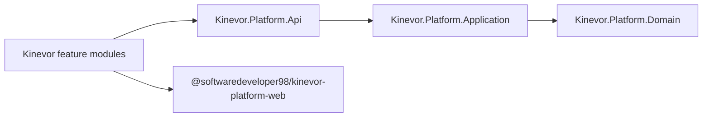

# Kinevor Platform

[](https://github.com/SoftwareDeveloper98/kinevor-platform/actions/workflows/ci.yml)
[](https://github.com/SoftwareDeveloper98/kinevor-platform/packages)
[](https://github.com/SoftwareDeveloper98/kinevor-platform/packages)
[](LICENSE)

Shared .NET and Angular building blocks for the Kinevor gym platform. The
repository has no product UI of its own; it supplies the contracts and services
that every feature module consumes.

## Packages

| Ecosystem | Package | Contents |
| --- | --- | --- |
| NuGet | `Kinevor.Platform.Domain` | Entities, aggregates, results, value objects, enums and specifications |
| NuGet | `Kinevor.Platform.Application` | Repository and unit-of-work contracts, current user, branch context, paging and exceptions |
| NuGet | `Kinevor.Platform.Api` | `ApiResponse<T>`, role constants and authorization policy extensions |
| npm | `@softwaredeveloper98/kinevor-platform-web` | API envelopes, auth gateway/interceptor/guard, i18n, notices and theme services |

## Architecture



Backend projects target `net9.0`; the Angular library targets Angular 21.

## Requirements

- .NET SDK 9.0 or 10.0.
- Node.js 22 or 24 and npm 10 or later.
- GitHub Packages credentials for consuming private packages.

## Build And Test

```powershell
dotnet test backend\Kinevor.Platform.slnx -c Release
dotnet pack backend\Kinevor.Platform.slnx -c Release -o backend\artifacts\packages

cd web
npm ci
npm run build
```

## Consume NuGet Packages

Configure the GitHub Packages source once:

```powershell
dotnet nuget add source https://nuget.pkg.github.com/SoftwareDeveloper98/index.json `
  --name github-kinevor `
  --username SoftwareDeveloper98 `
  --password $env:KINEVOR_PACKAGES_TOKEN `
  --store-password-in-clear-text
```

Then reference the packages:

```xml
<PackageReference Include="Kinevor.Platform.Domain" Version="0.1.0" />
<PackageReference Include="Kinevor.Platform.Application" Version="0.1.0" />
<PackageReference Include="Kinevor.Platform.Api" Version="0.1.0" />
```

## Consume The Angular Package

Create an `.npmrc` in the consuming workspace:

```ini
@softwaredeveloper98:registry=https://npm.pkg.github.com
//npm.pkg.github.com/:_authToken=${KINEVOR_PACKAGES_TOKEN}
```

Then install:

```powershell
npm install @softwaredeveloper98/kinevor-platform-web
```

Provide the shared services in the application bootstrap:

```ts
import {
  provideKinevorHttp,
  provideKinevorPlatform,
} from '@softwaredeveloper98/kinevor-platform-web';

export const appConfig = {
  providers: [
    provideKinevorHttp(),
    provideKinevorPlatform({ apiBaseUrl: '/api/v1' }),
  ],
};
```

## Local Development

Feature repositories can consume unpacked local artifacts instead of published
packages:

```powershell
dotnet pack backend\Kinevor.Platform.slnx -c Release -o backend\artifacts\packages
cd web
npm ci
npm run build
```

The sibling module repositories expose `npm run install:local` for the Angular
package.

## Release

1. Update `Directory.Build.props`, both `package.json` files and this changelog.
2. Commit and push the release state.
3. Create and push tag `v0.1.0`.
4. The release workflow publishes the three NuGet packages and the Angular
   package to GitHub Packages.

Publish this repository before every module release wave. Module CI restores
these packages from GitHub Packages. See [PUBLISHING.md](PUBLISHING.md) for the
complete release checklist.

Create a repository secret named `KINEVOR_PACKAGES_TOKEN` in consumer
repositories. A classic PAT needs `repo` and `read:packages`; use
`write:packages` only if the token also publishes packages. The platform release
workflow uses the repository `GITHUB_TOKEN` for publishing.

## Security

Demo modules are responsible for their own authentication adapters. Never commit
`.env` files, PATs or signing keys. Report security issues privately to the
repository owner.

## License

MIT. See [LICENSE](LICENSE).
